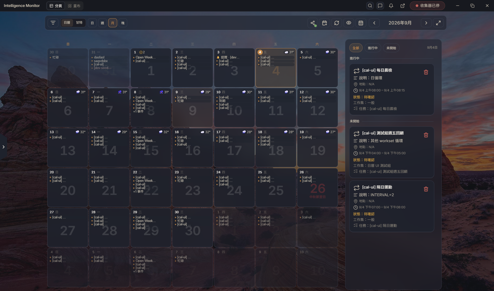
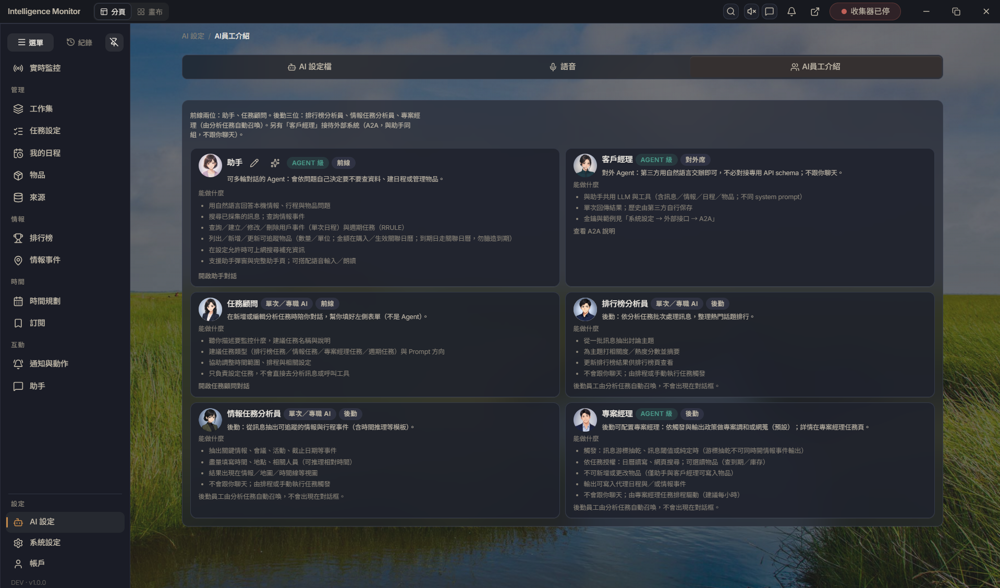
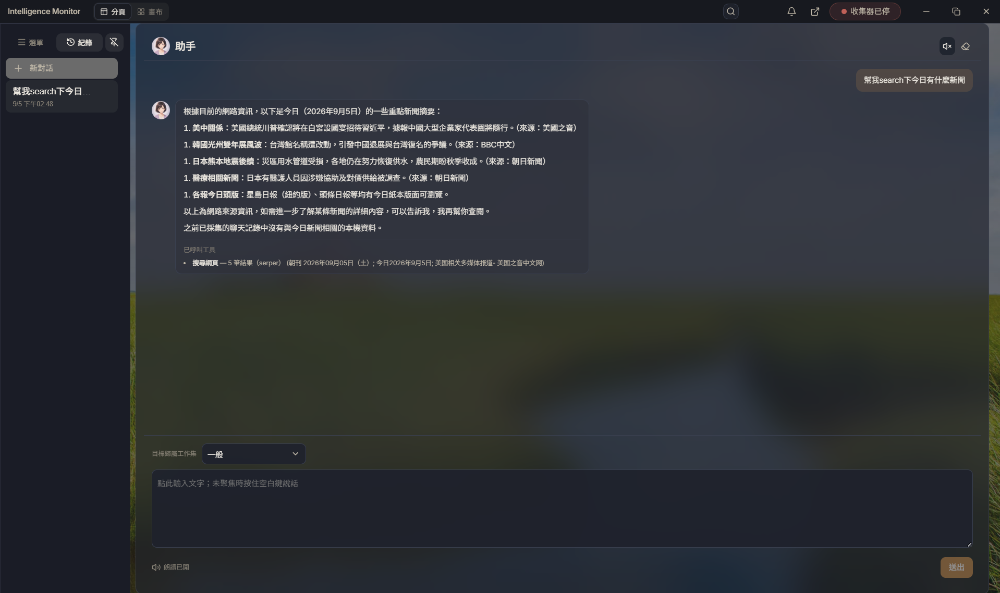
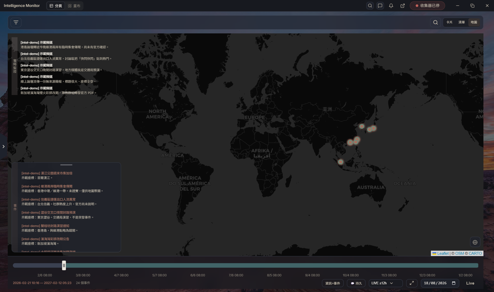
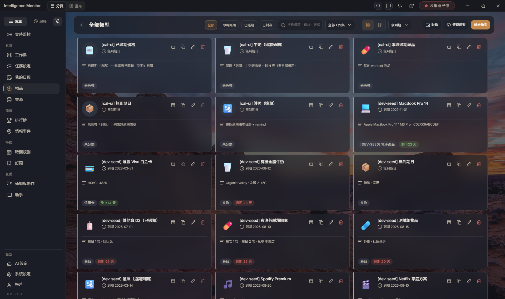
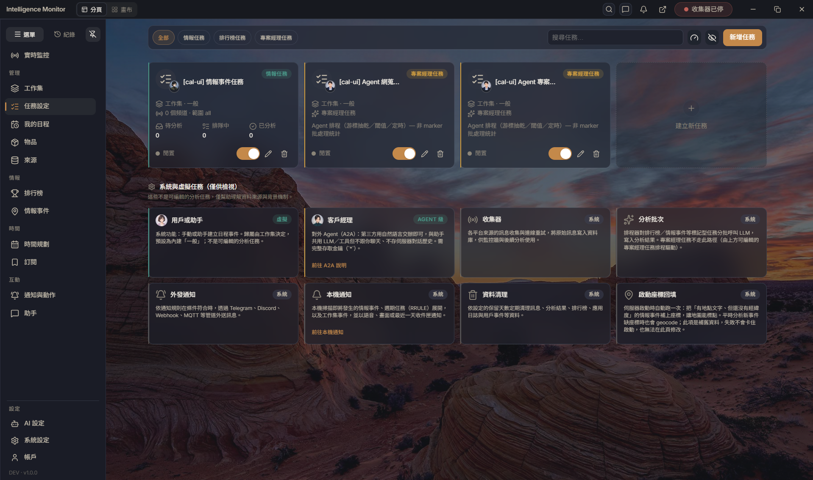

[繁體中文](README.md) | [简体中文](README.zh-Hans.md) | [English](README.en.md)

#  Intelligence Monitor

Intelligence Monitor is a **single-household** intelligence workstation you run on your own computer: ingest Telegram, Discord, RSS, MQTT, Email, and more, turn them into filterable intel and events, then place them on the calendar, tasks, items, and map. It is not a multi-tenant cloud service.

- **Personal intel filtering** — Filter intel events by space, analysis task, keyword, and time window; switch list / cards / map. The map can overlay live info and events, show either alone, and use a LIVE time window. The assistant can query the same local intel.
- **Multi-task management and output** — **Tasks** is its own nav (`/tasks`); tasks belong to spaces. Intel, leaderboard, project-manager, and recurring tasks run independently. Results land on intel events and the leaderboard; **Timeline** has month / Gantt. Outbound sharing publishes a space as a calendar ([https://subscribe.devents.tech](https://subscribe.devents.tech)), not a one-click report export.
- **Local-first household spaces** — Data stays in local SQLite by default. Spaces group intel, schedule, and items. You bring your own AI provider and keys.
- **Assistant on demand** — `Ctrl+J` (macOS `⌘+J`) opens the text composer; without it, **Flash** bubbles show voice / quick replies. Full chat lives on **Assistant**.

## Screenshots



Month calendar and the day's agenda.



Assistant, account manager, and back-office analyst roles.



Chat with the assistant to search intel or change the schedule.



Intel events on the map.



Item inventory and expiry.



Analysis tasks and monitor setup.

## Getting started

1. **Get the app** — install Desktop from [GitHub Releases](https://github.com/Wing9897/im/releases) (Windows / macOS / Linux). To develop or run from source:

   ```bash
   uv sync --extra dev --locked
   npm ci
   npm run dev
   ```

2. **First run** — create the household admin (one household, one admin). On Desktop, host the service locally or connect to an existing remote server (client).
3. **Sign in** — use the same account after that. The browser keeps a device session; you do not paste a key for normal use.
4. **Space** — open the space drawer on **Timeline** (`?workset=`) to create one. Tasks, items, handwritten events, and recurring events must belong to a space. You can start with the built-in General space (`__general__`). Deleting a custom space moves its rows back to General; General itself cannot be deleted.
5. **Sources and intel** — **Tasks and sources** for Telegram, Discord, RSS, MQTT, Email, and more; **Intel** for analysis results (list / cards / map) and the topics leaderboard.
6. **Calendar and tasks** — **Timeline** for month / Gantt; the toolbar **My schedule** button for handwritten events and recurring series. **Tasks and sources** is the sidebar item (`/tasks`) for what to monitor and analyze. Recurring calendar series expand RRULE at query time only and never trigger AI analysis. AI schedules support 10-second, hourly, daily, weekly, and custom-second presets.
7. **Items and map** — **Items** for inventory, expiry, and reminders. The intel page can switch to a map for events that have coordinates.
8. **Assistant** — `Ctrl+J` (macOS `⌘+J`) opens the text composer anytime. Without the composer, **Flash** bubbles show voice / quick replies briefly (then hide; switch to **Persist** to keep them). Full chat and history live on the **Assistant** page. Configure an AI provider in Settings first.
9. **Settings** — language, theme, AI provider keys, notifications, and external interfaces. Create access keys on Account (MCP / A2A need scope `*`). The MCP master switch and capability groups are under **Settings → External interfaces → MCP**.
10. **Upgrading an old database** — current is **schema stamp 7** (`SCHEMA_FLOOR` = current; production `SCHEMA_MIGRATIONS` is empty). Stamps 1–6 **hard-reject** — back up, then reset. For a **future stamp**, **update the application** first. Stop Desktop / `npm run dev`, then:

    ```bash
    uv run python scripts/reset_local_databases.py --apply
    ```

## External agents / MCP

Any Streamable HTTP MCP client can connect to `{API origin}/api/v1/mcp` (structured tools, not chat). Create a scope `*` access key on Account, then open **Settings → External interfaces → MCP** for the master switch and capability groups. OpenClaw is one example client. Contract: [`docs/agent/mcp.md`](docs/agent/mcp.md). System overview: [`docs/TECH.md`](docs/TECH.md).

For one-shot natural-language assign (the local runtime picks tools), use A2A (`POST /api/v1/a2a/agent`): [`docs/agent/a2a.md`](docs/agent/a2a.md).

## Calendar share (optional)

Calendar share is optional: publish a space as a public calendar so others can subscribe with a link or account.

- Public source: [https://subscribe.devents.tech](https://subscribe.devents.tech)
- In this app: Timeline toolbar **Search / manage subscriptions** → **Calendar share**, enter the **Server URL** (that address is the default) and sign in, then **My published** → **Publish a space**.
- Subscribers open the hub with a link or account to browse the public catalog, or add calendars under **Find calendars**. This app does not talk to the hub from the browser.

## Developers

```bash
uv sync --extra dev --locked
npm ci
npm run dev
npm run check
```

Python ≥ 3.11, Node.js ≥ 20.19.0. On Windows, a 0-byte `node` / `npm` stub in `C:\Windows\System32\` can shadow the real Node. Run `npm run check` before a PR (same Ubuntu quality gate as CI). `zh-Hant` is the UI-copy source of truth. Report security issues via [`SECURITY.md`](SECURITY.md), not a public issue.

Remaining contracts: [`docs/README.md`](docs/README.md). MIT ([`LICENSE`](LICENSE)).
